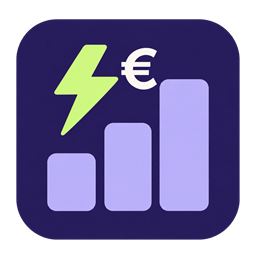

# Energy Cost Monitor za Home Assistant

Primerjaj dobavne ponudbe elektrike, spremljaj meritve in EV seje ter shrani
ponovljiva poročila iz obstoječih senzorjev Home Assistanta. Integracija podatke
bere in ne krmili naprav.

Dodaj Energy Cost Monitor kot repozitorij po meri v Home Assistant Marketplaceu.
V Home Assistantu 2026.10.2 uporabi HACS.

**[Začni tukaj: namestitev in uporabniški vodič](docs/getting-started.sl.md)** ·
[English](README.md)

## Kaj je novega v različici 0.1.0

- Na računalniku ali telefonu preklapljaj med pregledom, cenami, polnjenjem, poročili in nastavitvami.
- Vnesi cene in datume veljavnosti z vodenim obrazcem ter primerjaj ponudbe po imenih.
- Preimenuj uvožene ponudbe in ohrani njihove cene ter prejšnja poročila.
- Po prekinitvi zapisa SQLite ob zagonu razveljavi nedokončani zapis in nadaljuje zajem.

[Opombe izdaje](https://github.com/MrCodeLabs/ha-energy-cost-monitor/releases/tag/0.1.0) ·
[Dnevnik sprememb](CHANGELOG.md)

Prejšnje predizdaje so zbrane v [GitHub Releases](https://github.com/MrCodeLabs/ha-energy-cost-monitor/releases).

## Kaj lahko nastaviš

- Voden izbor senzorjev; sončna elektrarna, hranilnik, EV in TČ so izbirni.
- Samodejno skrbniško ploščo z obrazci za cene, profile in poročila.
- Obdobja cen prevzema/oddaje, naročnino in izbirne referenčne cene.
- EV izračun iz števca, opažene načine, regionalne postavke za Slovenijo 2026
  ter uvajanje študije z mesečnimi in končnimi poročili.
- Voden uvoz podprte kopije SQLite starega Energy Cost Monitorja.

Za podprti postopek ni treba dopisovati kode ali urejati JSON/YAML. Plošča je
privzeto angleška; slovenski jezik uporabnika HA vključi slovenski prevod.
Drugi jeziki uporabljajo angleščino. Potreben je skrbniški račun. Podprt je en vnos integracije
na namestitev HA.

## Kaj je preverjeno in kaj še manjka

V ločenem HA 2026.11 so s sintetičnimi podatki preizkušeni čista namestitev,
nadgradnja bete, obnova SQLite in povratek. Prejšnji preizkusi HACS v HA
2026.10.2 so opisani v [zapisniku preverjanja](docs/acceptance-2026-11-02.md).
Za obstoječo namestitev upoštevaj
[navodila za nadgradnjo in obnovo](docs/getting-started.sl.md#7-posodobitve-kopije-in-odstranitev).

Regionalne ocene temeljijo na pravilih za Slovenijo v letu 2026. Uskladitev z
računom, prenos dobroimetja, izplačila, pravila za 2027 in celotna obnova
HAOS ostajajo zunaj preverjenega obsega te izdaje.

## Zasebnost in pomoč

Nastavitve, meritve in poročila ostanejo v tvojem HA. Izbirni zajem Energy-Charts
pošlje območje/datum ponudniku, ki vidi tudi omrežni naslov odjemalca. Javni repo
vsebuje splošno kodo in izmišljene primere.

Pri [prijavi težave](https://github.com/MrCodeLabs/ha-energy-cost-monitor/issues)
navedi različici HA/HACS, nameščeni commit in anonimizirane korake. Ne prilagaj
žetonov, zasebnih dnevnikov, računov, identifikatorjev merilnih mest ali hišnih baz.

Razvojne podrobnosti: [načrt](ROADMAP.md), [zgodovina preverjanj](docs/validation-status.md),
[spremembe](CHANGELOG.md), [arhitektura](docs/architecture.md),
[razvoj](docs/development.md) in [izvor kode](docs/provenance.md).
Licenca: [MIT](LICENSE). Datirani starejši zapisi so razvojna zgodovina;
za prvo namestitev uporabi zgornji uporabniški vodič.
